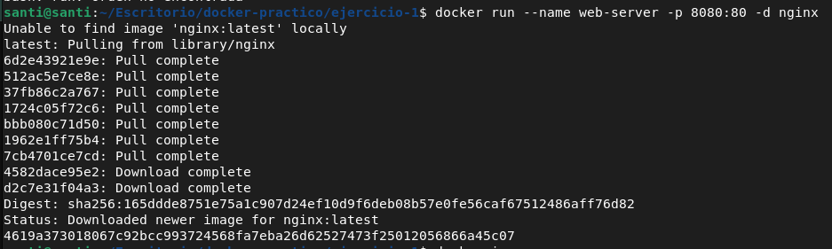
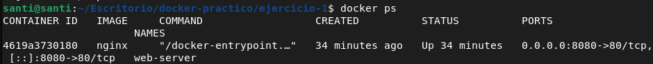
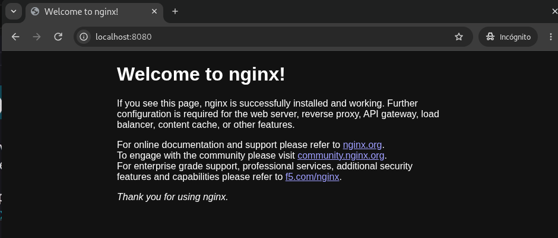
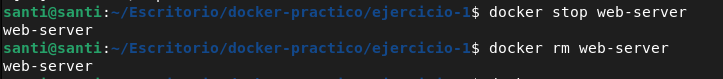

# Nginx Web Server con Docker

Se necesita levantar un servidor web Nginx usando Docker, accesible desde el navegador, sin afectar el host, y poder gestionar el contenedor facilmente: crear y ejecutar el contenedor con nombre y puerto mapeado, verificar que este activo, acceder desde el navegador, detenerlo y finalmente eliminarlo. El resultado esperado es que Nginx funcione correctamente, sea accesible y el contenedor pueda detenerse y eliminarse sin problemas.

### Paso 1: Primer comando
```
docker run --name web-server -p 8080:80 -d nginx

```
- **docker run**: indica a docker que cree un nuevo contenedor y lo ponga en marcha
- **--name web-server**: Asigna el nombre web-server al contenedor, en caso de no asignar un nombre se le asignara uno aleatorio
- **-p 8080:80**: mapea los puertos de la computadora con el contenedor
    - **8080**: (Host) puerto de la computadora host
    - **80**: (contenedor) es el puerto interno donde Nginx escucha el trafico
- **-d**: (detached) el contenedor se ejecuta en segundo plano
- nginx : es el nombre de la imagen oficial de Nginx en Docker Hub



### Paso 2: Verificar que el contenedor esta corriendo

```
docker ps

```



### Paso 3: Verificar que Nginx este corriendo en el puerto



### Paso 4: Detener y eliminar el contenedor

```
docker stop <CONTAINER_ID>
docker rm <CONTAINER_ID>

```

