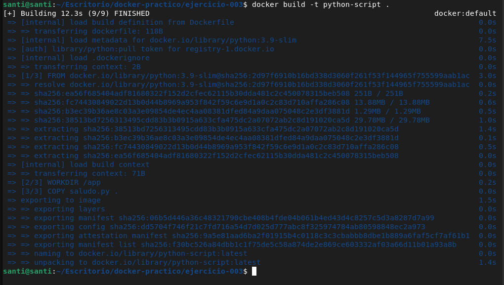
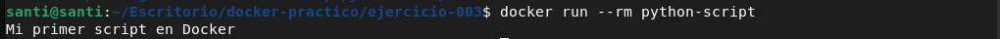

# Ejercicio 4

Se necesita crear una imagen Docker que ejecute automaticamente un script de Python, de manera que el condigo pueda correr dentro de un contenedor sin depender del entorno del host. Para ello, crea un script llamado saludo.py que imprima eñ mensaje "Mi primer script en Docker!!!", define un Dockerfile que use una imagen base de Python, copie el script al contenedor y lo ejecute al iniciar, contruye la imagen Docker y ejecuta el contenedor a partir de ella. El resultado esperado es que al correr el contenedor, se muestre el mensaje del script en la consola y el contenedor se elimine automaticamente si se utiliza la opcion correspondiente, demostrando que el contenedor ejecuta codigo de Python de manera independiente y reproducible.

### Paso 1: Crear el archivo Dockerfile

```

FROM python:3.9-slim -> Usamos la version de python que necesitemos

WORKDIR /app -> Definimos el directorio de trabawjo

COPY saludo.py . -> Copiamos el archivo

CMD ["python", "saludo.py"]-> Comando que vamos a utilizar al iniciar el contenedor

```

### Paso 2: Hacemos el build del archivo

Desde el directorio en donde se encuentra el Dockerfile ejecutamos el siguiente comando

```
docker build -t python-script .

```
- **-t**: nombre del tag



### Paso 3: Corremos el contenedor y lo eliminamos al finalizar

```
docker run --rm python-script

```

- **-rm**: elimina el contenedor automaticamente al terminar la ejecucion

