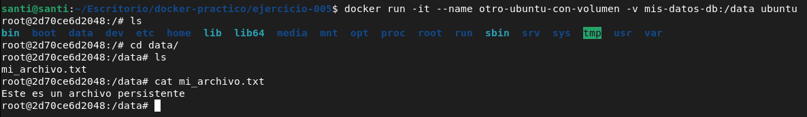

# Ejercicio 6

Se necesita trabajar con volumenes en Docker para almacenar datos de manera persistenete aunque los contenedores se eliminen. Para ello, crea un contenedor de Ubuntu con un volumen, guarda un archivo denrtro del volumen , cierra y elimina el contenedor, y luego crea un nuevo contenedor reutilizando el mismo volumen para verificar que el archivo persiste. El resultado esperado es que los datos guardados en el volumen permanezcan accesibles incluso despues de eliminar el primer contenedor.

**Definicion de Volumen:**Es un directorio especial que lo almacena Docker y lo almacena en el sistema de archivos del host.

### Paso 1: Corremos el comando

```
docker run -it --name mi-ubuntu-con-volumen -v mis-datos-db:/data ubuntu

```
- **-v mis-datos-db:/var/lib/docker/volumes/**: Crea o monta un volumen para persistir datos:
	- **mis-datos-db**: Es el nombre del volumen en tu máquina real (host).
	- **-v mis-datos-db:/data**: Es la ruta dentro del contenedor donde se conectará ese volumen. Todo lo que guardes ahí dentro no se borrará aunque apagues o elimines el contenedor
- **ubuntu**: Es la imagen base oficial del sistema operativo Ubuntu que se utilizará para crear el contenedor.

### Paso 2: Creamos un archivo persistente dentro del servidor
```
echo "Este es un archivo persistente" > /data/mi_archivo.txt

```

### Paso 3: Salimos del contenedor y lo eliminamos

```
> exit

docker rm <CONTAINER_ID>

```

### Paso 4: Creamos otro contenedor con otro volumen

```
docker run -it --name otro-ubuntu-con-volumen -v mis-datos-db:/data ubuntu

```

